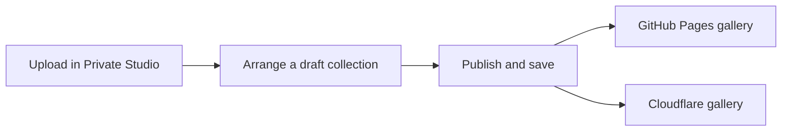

# How to open and manage your photography website

Updated 28 October 2026 for the current repository. Use the private Studio to manage photographs and site text; use the repository to change design or functionality.

**[Open the website](https://sheep05.github.io/) · [Open the private Studio](https://quiet-studio-backend.sheep05.workers.dev/studio) · [Repository folder map](README.md#what-each-folder-does)**

## 1 Open the website from GitHub

On [your repository page](https://github.com/sheep05/sheep05.github.io), scroll below the folders and files to the README. Click **→ Open the photography website** under **Open the website**.

| Entrance | What opens |
| --- | --- |
| [Main website](https://sheep05.github.io/) | The public 3D room entrance, followed by your photography gallery. Share this address with visitors. |
| [Direct collection](https://sheep05.github.io/?view=collection) | The public collection without going through the room entrance. |
| [Private Studio](https://quiet-studio-backend.sheep05.workers.dev/studio) | Your upload and editing dashboard. Choose **Sign in with GitHub** and use `sheep05`. |
| [Cloudflare website](https://quiet-studio-backend.sheep05.workers.dev/) | Another public entrance to the gallery, using the same published photo library. |
| [GitHub repository](https://github.com/sheep05/sheep05.github.io) | Source files, documentation, and version history. This address opens the project rather than the photography website. |

The public website also has a **Studio management** link in its footer. Visitors can browse without a GitHub or ChatGPT account and do not need Blender installed; only your configured GitHub owner account can edit.

## 2 Upload and publish your photographs

For example, to publish a collection called **Japan at night**:

1. Open the [Private Studio](https://quiet-studio-backend.sheep05.workers.dev/studio) and sign in as `sheep05`. On the first visit, GitHub may ask you to authorize Quiet Studio; the application uses your public profile identity without repository or private-email scopes.
2. Choose **Collections → + New collection**. Enter **Japan at night**, add a description if you want, and click **Create collection**. New collections start as drafts.
3. Choose **Photographs**. Set the **Upload to** dropdown to **Japan at night · Draft**.
4. Click **Choose photographs** or drag images into the upload area. Wait for the completion notice and check for errors.
5. Click a photograph to edit its **Title**, **Caption**, and **Image description**, then **Save changes**. The image description is for people using screen readers.
6. Open **Collections → Arrange photographs** to set the sequence. Drag photographs or use the left/right arrows; clear any search text first.
7. Open **Edit collection**, select a **Cover photograph**, and use **Preview collection** to review the draft while signed in.
8. Check **Publish this collection → Save changes**. Reload the GitHub and Cloudflare websites to see it publicly.



Both websites read the same Cloudflare library. You upload once; publishing photos does **not** require editing GitHub, rebuilding the website, or making a commit. New images can take a minute or more to appear everywhere, and already open pages need to be reloaded.

Supported uploads are JPG, PNG, WebP and AVIF, up to 50 MB and 100 megapixels per file. Export RAW or HEIC images as JPEG first. The browser creates a JPEG web copy up to 3200 pixels on its longest edge and an 800-pixel preview, removing EXIF/GPS metadata; keep your original files separately.

## 3 Edit photos, albums, and site text

| Task | Dashboard action |
| --- | --- |
| Rename a photo or change its caption | **Photographs → click the photo → edit → Save changes** |
| Include one photo in multiple albums | Check the albums under **Include in collections** in the photo editor |
| Remove a photo from just one album | Uncheck that album and save; the photo stays in your library |
| Reorder albums | Use the up/down arrows in **Collections** |
| Change an album name, description, or cover | **Collections → Edit collection** |
| Hide an album | Uncheck **Publish this collection**, then save |
| Replace the image itself | Upload the revised image, assign its albums/order/cover, then delete the old image when satisfied; there is no replace-file button yet |
| Delete an album | Use its **Delete** action; its photographs remain in your library |
| Delete a photograph | Use the photo's **Delete** action; it is removed from every album, with no dashboard undo |
| Rename the website or edit the opening line, biography, or contact email | **Studio settings → edit → Save changes** |
| Hide the demonstration photographs | In **Studio settings**, uncheck **Show the sample collections**, then save |

A photograph is public if it belongs to **any published collection**. Hiding one album does not hide the same photo in another published album. Upload to a draft or **Unfiled photographs** when you want to review images privately first; uploading directly into a published collection makes them public.

Changing the Studio's website name does not change `sheep05.github.io` or the GitHub application's sign-in name. The GitHub Pages browser-tab title is in `frontend/index.html`; the Cloudflare page title follows the Studio name through `app/page.tsx`.

## 4 Understand the current repository

There are nine top-level project folders. `frontend/` replaced the old `pages-preview/`, and migrations moved from `drizzle/` to `db/migrations/`.

| Folder | Function |
| --- | --- |
| [`app/`](app/) | Website pages, gallery/room components, the private Studio, and API/sign-in routes. |
| [`frontend/`](frontend/) | The GitHub Pages entry that loads published content from Cloudflare. |
| [`lib/`](lib/) | Shared photo/album types, database queries, sample data, and owner-session helpers. |
| [`db/`](db/) | Database schema and the SQL migration history in `db/migrations/`. |
| [`public/`](public/) | Source assets: room model, fallback image, sample photos, and favicon. |
| [`docs/`](docs/) | The compiled website GitHub Pages publishes from `main /docs`. |
| [`scene-source/`](scene-source/) | Editable Blender room, textures, scene-generation scripts, and visual checks. |
| [`tests/`](tests/) | Checks for owner sign-in, uploads, albums, and private-photo access. |
| [`worker/`](worker/) | The Cloudflare application's request entry point. |

Your uploaded images are in **Cloudflare KV**, and their titles, album membership and settings are in **Cloudflare D1**. They are not stored in these GitHub folders. The repository README also explains [root configuration files](README.md#important-root-files) and [local generated folders](README.md#folders-visible-only-on-your-computer).

The short summaries beside files on GitHub are their latest commit messages. They currently describe each item's purpose, but future commits will replace those labels.

## 5 Choose the right way to make a change

| Change | Where to edit | How it goes live |
| --- | --- | --- |
| Photos, collections, website name, biography | Private Studio | Save/publish, then reload either website |
| Instructions or folder descriptions | Markdown files on GitHub | Commit the documentation change |
| Gallery layout | `app/components/Portfolio.tsx` | Rebuild/publish GitHub Pages and deploy Cloudflare for both sites |
| Colors, fonts, spacing | `app/globals.css` | Rebuild/publish both sites |
| Walking pace or camera motion | `app/components/Room.tsx` | Rebuild/publish both sites |
| Room furniture or geometry | `scene-source/quiet-studio.blend` and scene tools | Export to `public/scene/`, then rebuild/publish both sites; see the [scene guide](scene-source/README.md) |
| GitHub Pages tab title or frontend connection | `frontend/index.html` or `frontend/main.tsx` | Rebuild/publish GitHub Pages |
| Photo-management interface or upload behavior | `app/studio/Studio.tsx` or `app/api/studio/route.ts` | Build and deploy Cloudflare |
| Database structure | `db/schema.ts` and `db/migrations/` | Generate/review migrations, apply pending changes, and deploy the backend |

**A GitHub source-code commit alone does not rebuild or deploy the application.** There is no automatic source-build workflow configured yet. GitHub Pages publishes the files already built in `docs/`; Cloudflare is deployed separately.

## 6 Build and publish a code change

These are terminal commands run in your local project folder, **quiet-studio-github**. Use Node.js 22.13 or newer. For a first-time checkout on another computer, clone the repository into that folder; on this computer, use the existing checkout.

Install dependencies after cloning or when the dependency files change:

```sh
cd quiet-studio-github
npm run install:ci
```

Preview the public frontend with your live photo library:

```sh
VITE_STUDIO_BACKEND_URL=https://quiet-studio-backend.sheep05.workers.dev npm run dev:pages
```

Open the localhost address printed in the terminal. Stop the preview with **Ctrl+C** before continuing in that terminal.

### Publish the GitHub Pages frontend

After editing and checking your source:

```sh
VITE_STUDIO_BACKEND_URL=https://quiet-studio-backend.sheep05.workers.dev npm run build:pages
rsync -a --delete --exclude=README.md outputs/github-pages/ docs/
git status
git diff --stat
```

The copy replaces generated files inside `docs/` and preserves its explanatory README. Keep this destination exactly `docs/`. If you later use a custom-domain `CNAME` file, keep its source in `public/CNAME` so the build includes it.

In your Git client, select the intended source changes and generated `docs/` changes, **commit**, then **push to main**. On GitHub, check **Actions** for the Pages deployment to finish, then reload the live site. Avoid editing generated JavaScript/CSS inside `docs/assets/` directly; the next build replaces it.

### Publish the Cloudflare backend

With Wrangler authenticated to your Cloudflare account:

```sh
npm run build
npx wrangler deploy --config dist/server/wrangler.json
```

A shared gallery/style change needs **both** publishing steps to update both websites. Dashboard/API-only changes need the Cloudflare step. See [technical setup](FULL-APP.md) for Wrangler authorization, local API testing, and database migrations; keep the GitHub client secret in Cloudflare secret storage.

## 7 If an update does not appear

| Symptom | Check |
| --- | --- |
| Uploaded photo is missing publicly | It belongs to a collection with **Publish this collection** checked and saved; allow storage propagation, then reload |
| Sample collections still appear | Uncheck **Show the sample collections** in Studio settings |
| Sign-in is rejected | Use the `sheep05` GitHub account; signing into ChatGPT does not sign you into the Studio |
| Code changed on GitHub but the website looks the same | Rebuild and commit `docs/`, or deploy Cloudflare, according to the change table above |
| Only one website has the new design | Complete the other site's publishing step |
| An upload fails | Check its displayed error, file type/size, connection, and free storage/operation limits |

The selected free photo storage allowance is 1 GB. Keep your original photographs separately, and back up the live database/photo storage before migration; a GitHub source-code backup does not contain uploaded photos. Your GitHub and Cloudflare accounts own the website independently of your ChatGPT account.
