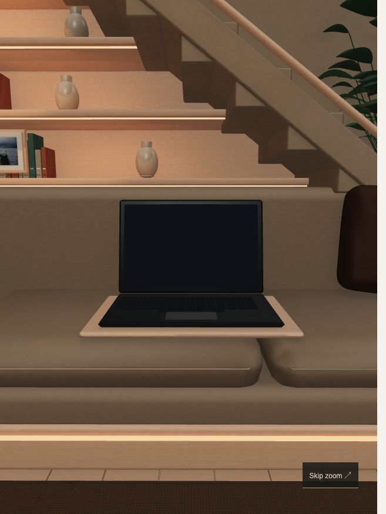

# Original sofa lounge

This is the editable Blender source for the sofa-room entrance. All room geometry was authored for this website; it does not contain a purchased or copied third-party scene. Its arrangement follows the approved visual concept, with an open laptop on the sofa, an under-stair library, a closed night window, and photography objects.

## Rebuild

Use Blender 4.5 LTS and run these commands from the repository root:

```sh
blender --background --python scene-source/lounge/build_lounge.py
blender --background --python scene-source/lounge/bake_lounge.py
```

`build_lounge.py` makes the original geometry, applies the photographed CC0 material maps, saves a portable packed `sofa-lounge.blend`, and renders the preview. The `.blend` keeps furniture, books, plants, and architectural parts individually editable.

`bake_lounge.py` makes two diffuse-illumination atlases, then batches the static interior and distant houses for the web export. The two 4096-pixel atlases contain the full warm night lighting and its lamp-off counterpart, including indirect bounce and contact shadows, so a browser does not need to calculate these effects in real time. The lamp, display, and moving curtains remain separate. The final GLB uses Draco mesh compression; the website bundles its decoder locally without a third-party CDN. First-visit offline loading is not provided.

## Files and editing

- `sofa-lounge.blend`: open this in Blender for material, geometry, and lighting changes. A change made only here must also be reflected in the build script if the room should remain reproducible.
- `build_lounge.py`: room layout, materials, furniture detail, laptop dimensions, source lighting, and authored camera composition.
- `bake_lounge.py`: web mesh batching, UV atlas generation, and lamp-on/off light baking.
- `textures/`: photographed CC0 material sources and derived neutral/tinted color maps. See their provenance file for source authors and licenses.
- `preview.jpg`: a render of the actual Blender scene, rather than the earlier illustrative concept.
- `../../public/scene/lounge/`: the optimized GLB, lightmaps, preview image, and machine-readable interaction interface used by the website.

The X-T5 is provided by the website's existing camera component and placed at `CameraPropAnchor`; it is intentionally not duplicated in this source.

## Runtime interface

Blender coordinates are Z-up; glTF export converts them to Y-up. Named empty objects `ScreenTopLeft`, `ScreenTopRight`, and `ScreenBottomLeft` define the exact visible laptop display corners in world space. `OverviewCamera`, `OverviewTarget`, `CameraPropAnchor`, `LampTarget`, and `WindowTarget` define navigation and interaction positions without hardcoded guesses.

The lightmap is transported in glTF's emissive texture channel with UV set 1 and `bakedIrradiance` material metadata. The Three.js adapter moves it into `lightMap`, uses linear color space, clears emission, and blends the second atlas for the lamp switch. The source scene's lighting therefore remains portable to other hosting providers; it has no Cloudflare dependency.

`GalleryScreen`, `CurtainLeft`, `CurtainRight`, and `GalleryPrint* photograph` stay separate to support screen projection, curtain movement, and replacing the displayed photographs.

## Preview and verification



This is a browser capture; `preview.jpg` is the Blender render. The web scene uses the same original geometry and textures, with baked lighting adapted to Three.js rather than a pixel-identical Cycles render. Daylight is an additional real-time light, while the interior lamp blends two baked states.

The exported room has 69,796 triangles and 21 meshes; the complete browser scene including the X-T5 rendered in 59 draw calls during local verification. The GLB is 15.44 MiB, with a separate 2.7 MiB lamp-off atlas and locally bundled decoder. On narrow/touch devices, lighting atlases are reduced to 2048 pixels in GPU memory. Slow loads and unavailable WebGL retain direct gallery access.

Validated locally: TypeScript, production Pages build, public-copy verification, 28 automated checks, direct laptop/camera/lamp/window interactions, and the laptop-to-gallery handoff. Projection tests cover portrait, landscape, desktop, and ultrawide proportions. Device-specific performance is not guaranteed by the desktop browser check.
